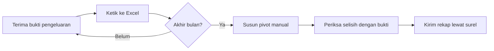
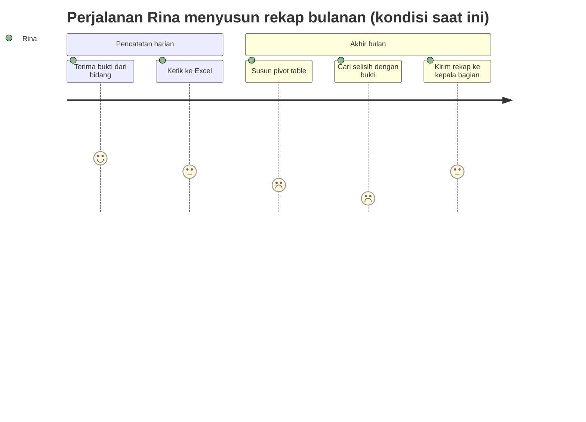
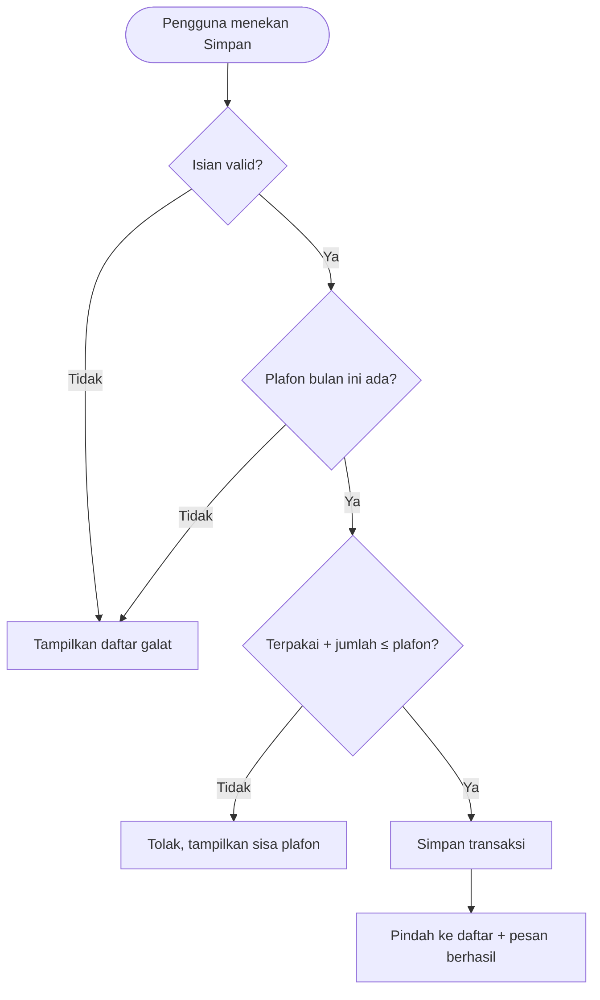
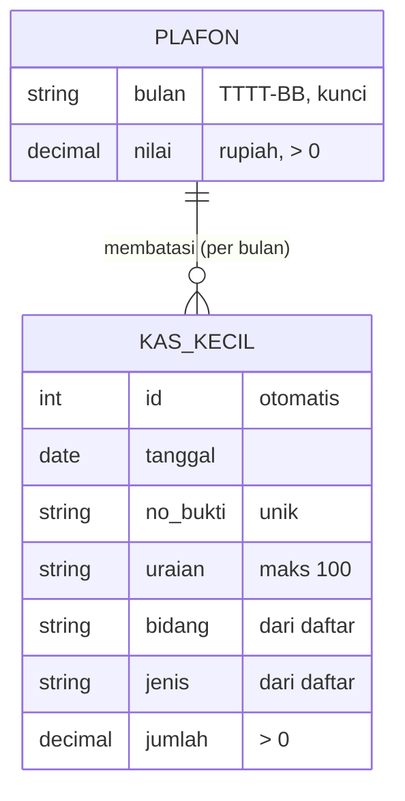
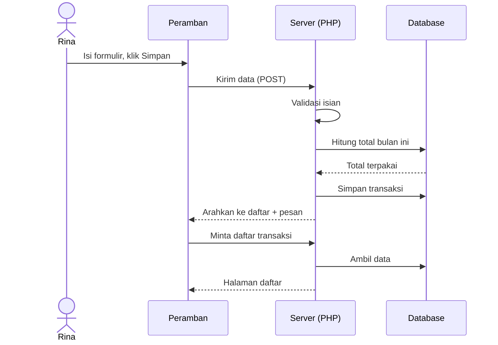

# PRD — Aplikasi Kas Kecil

| | |
|---|---|
| **Versi** | 1.0 |
| **Tanggal** | 3 November 2026 |
| **Status** | Disetujui untuk proyek akhir pelatihan |
| **Penyusun** | Tim pengajar pelatihan Pemrograman Web untuk Administrasi & Keuangan |
| **Pemilik produk** | Kepala Bagian Keuangan & Umum, Kantor Unit Contoh (fiktif) |
| **Pemangku kepentingan** | Pemegang kas kecil, kepala bidang, Bagian Keuangan & Umum |
| **Persetujuan diperlukan dari** | Pemilik produk |

> **Catatan pelatihan.** Kantor Unit Contoh, nama orang, dan seluruh angka dalam dokumen ini fiktif. Dokumen ini menjadi contoh PRD sederhana yang dapat ditiru peserta saat menyusun usulan kebutuhan aplikasi di unit masing-masing.

### Riwayat revisi

| Versi | Tanggal | Penyusun | Ringkasan perubahan |
|---|---|---|---|
| 0.1 | 27 Oktober 2026 | Tim pengajar | Draf awal dari hasil diskusi proses kas kecil |
| 1.0 | 3 November 2026 | Tim pengajar | Penambahan aturan plafon, ekspor CSV, dan rekap silang |

---

## 1. Ringkasan Eksekutif

Pencatatan kas kecil di Kantor Unit Contoh masih memakai lembar Excel yang disimpan di komputer pemegang kas. Setiap akhir bulan, rekap per bidang disusun ulang secara manual, posisi sisa plafon baru diketahui setelah dihitung, dan file sering berbeda versi antarpegawai. Aplikasi Kas Kecil menggantikan lembar tersebut dengan satu sumber data bersama berbasis web.

Rilis pertama mencakup lima kemampuan: mencatat transaksi dengan validasi, mencari dan menyaring transaksi, mengubah atau menghapus transaksi yang salah, melihat dasbor posisi plafon beserta grafik, serta menyusun rekap silang bidang × jenis biaya yang siap cetak dan dapat diunduh ke Excel. Sasaran utamanya adalah memangkas waktu penyusunan rekap bulanan dari sekitar 2 jam menjadi kurang dari 5 menit, dan mencegah pengeluaran melampaui plafon bulanan.

Aplikasi dibangun oleh peserta sebagai proyek akhir Hari 2 dengan estimasi 3–4 jam kerja, memakai teknologi yang telah dipelajari selama pelatihan.

---

## 2. Latar Belakang dan Pernyataan Masalah

### 2.1 Konteks dan situasi saat ini

Pemegang kas kecil mencatat setiap pengeluaran (ATK, konsumsi rapat, BBM, perlengkapan K3, dan lain-lain) ke lembar Excel. Satu baris berisi tanggal, nomor bukti, uraian, bidang, jenis biaya, dan jumlah. Plafon kas kecil ditetapkan per bulan, misalnya Rp 10.000.000.

Pada akhir bulan, pemegang kas membuat pivot table untuk merekap per bidang dan per jenis biaya, lalu mengirimkannya ke kepala bagian. Bila kepala bidang menanyakan sisa dana di tengah bulan, pemegang kas harus membuka file dan menghitung terlebih dahulu.

*Gambar 1 — Proses kas kecil saat ini.* Titik lemahnya ada pada langkah B dan D: data tidak divalidasi saat diketik, sehingga kesalahan (nomor bukti ganda, bidang salah ketik) baru ditemukan ketika rekap disusun.

### 2.2 Pernyataan masalah

> Pemegang kas kecil **tidak dapat mengetahui posisi plafon secara langsung** dan **menghabiskan sekitar 2 jam setiap akhir bulan** untuk menyusun dan memeriksa rekap, karena data tersimpan di lembar kerja pribadi tanpa validasi isian. Akibatnya, pengeluaran berisiko melampaui plafon dan rekap rawan selisih.

### 2.3 Peluang dan alasan waktunya sekarang

Peserta pelatihan telah menguasai formulir web, validasi, database, dan kueri rekap. Proses kas kecil dipilih karena datanya sederhana, frekuensinya tinggi, dan manfaatnya langsung terasa.

### 2.4 Alternatif yang dipertimbangkan

| Alternatif | Kelebihan | Alasan tidak dipilih |
|---|---|---|
| Tetap memakai Excel dengan template terkunci | Tanpa pengembangan | Tetap satu file per orang, tidak ada validasi plafon otomatis |
| Spreadsheet daring bersama | Mudah diakses bersama | Validasi lemah, rumus mudah terhapus, riwayat sulit ditelusuri |
| Aplikasi web sederhana (dipilih) | Validasi di server, satu sumber data, rekap otomatis | Perlu dikembangkan dan dipasang |

---

## 3. Tujuan dan Metrik Keberhasilan

Tujuan dirumuskan agar dapat dibuktikan saat demo proyek akhir. Angka garis dasar adalah perkiraan dari proses manual.

### 3.1 Tujuan bisnis

| ID | Tujuan | Metrik | Garis dasar | Target | Tenggat |
|---|---|---|---|---|---|
| G-01 | Mempercepat penyusunan rekap bulanan | Waktu dari membuka data hingga rekap siap cetak | ±120 menit | ≤ 5 menit | Demo proyek akhir |
| G-02 | Mencegah pengeluaran melampaui plafon | Jumlah bulan dengan total > plafon | Tidak terpantau | 0 | Sejak rilis |
| G-03 | Meningkatkan ketepatan data | Persentase transaksi dengan nomor bukti ganda atau isian tidak valid | Tidak terpantau | 0% | Sejak rilis |
| G-04 | Posisi kas dapat dilihat kapan saja | Waktu untuk menjawab "berapa sisa plafon bulan ini?" | ±10 menit | ≤ 10 detik | Demo proyek akhir |

### 3.2 Metrik pelindung

| Metrik | Batas yang tidak boleh dilanggar |
|---|---|
| Waktu mencatat satu transaksi | Tidak lebih lama dari mengetik satu baris Excel (±1 menit) |
| Kehilangan data | Tidak ada transaksi hilang akibat kirim ganda atau muat ulang halaman |

### 3.3 Cara pengukuran

| Metrik | Sumber data | Penanggung jawab | Frekuensi |
|---|---|---|---|
| Waktu rekap | Uji coba berwaktu saat demo | Peserta | Sekali saat demo |
| Pelanggaran plafon | Halaman Rekap Bulanan | Pemegang kas | Bulanan |
| Data tidak valid | Upaya simpan yang ditolak validasi | Peserta | Saat pengujian |

### 3.4 Bukan tujuan

- Menggantikan sistem keuangan resmi perusahaan. Aplikasi ini hanya alat bantu pencatatan kas kecil di tingkat unit.
- Mengelola proses penggantian (*reimbursement*) dan persetujuan berjenjang.

---

## 4. Persona Pengguna dan Perjalanan Pengguna

Dua persona dipilih karena masing-masing menghasilkan kebutuhan yang berbeda: pemegang kas membutuhkan pencatatan yang cepat dan aman, sedangkan kepala bagian membutuhkan ringkasan sekilas.

### 4.1 Persona

#### P-01 — Rina, pemegang kas kecil

| Aspek | Keterangan |
|---|---|
| Peran | Staf administrasi yang memegang dan mencatat kas kecil |
| Kemahiran teknologi | Mahir Excel, belum pernah memakai aplikasi web internal |
| Frekuensi pemakaian | 2–5 kali per hari kerja |
| Perangkat | Laptop kantor |
| Tujuan utama | Mencatat cepat tanpa salah, menyusun rekap tanpa lembur |
| Titik frustrasi | Salah ketik baru ketahuan saat rekap; harus menghitung sisa plafon manual |
| Ukuran keberhasilan baginya | Rekap akhir bulan selesai dalam hitungan menit |

#### P-02 — Pak Andi, kepala bagian keuangan & umum

| Aspek | Keterangan |
|---|---|
| Peran | Pengawas penggunaan kas kecil |
| Kemahiran teknologi | Pengguna umum; lebih sering membaca laporan |
| Frekuensi pemakaian | 1–2 kali per minggu |
| Perangkat | Laptop dan ponsel |
| Tujuan utama | Mengetahui posisi plafon dan bidang dengan pengeluaran terbesar |
| Titik frustrasi | Harus menunggu kiriman rekap untuk mengetahui posisi kas |
| Ukuran keberhasilan baginya | Posisi kas terbaca dalam satu layar |

### 4.2 Perjalanan pengguna

*Gambar 2 — Perjalanan pengguna saat ini.* Nilai terendah ada pada penyusunan pivot dan pencarian selisih. Kedua langkah tersebut menjadi sasaran utama aplikasi: validasi saat mencatat (FR-02) menghilangkan pencarian selisih, dan rekap otomatis (FR-07) menghilangkan penyusunan pivot.

### 4.3 User story

| ID | User story | Persona | Prioritas |
|---|---|---|---|
| US-01 | Sebagai pemegang kas, saya ingin mencatat transaksi lewat formulir agar data langsung tersimpan rapi | P-01 | Must |
| US-02 | Sebagai pemegang kas, saya ingin ditolak bila transaksi melampaui plafon agar tidak terjadi kelebihan pengeluaran | P-01 | Must |
| US-03 | Sebagai pemegang kas, saya ingin mencari transaksi berdasarkan bulan, bidang, atau kata kunci agar mudah menelusuri bukti | P-01 | Must |
| US-04 | Sebagai pemegang kas, saya ingin memperbaiki atau menghapus transaksi yang salah | P-01 | Must |
| US-05 | Sebagai kepala bagian, saya ingin melihat sisa plafon dan grafik pengeluaran dalam satu layar | P-02 | Must |
| US-06 | Sebagai pemegang kas, saya ingin rekap bidang × jenis biaya yang siap dicetak | P-01, P-02 | Should |
| US-07 | Sebagai pemegang kas, saya ingin mengunduh data ke Excel untuk diolah lebih lanjut | P-01 | Should |

---

## 5. Ruang Lingkup

Ruang lingkup disesuaikan dengan waktu proyek akhir (3–4 jam). Fitur yang menuntut konsep di luar materi pelatihan, seperti login dan persetujuan berjenjang, sengaja ditunda.

### 5.1 Termasuk dalam ruang lingkup

| Kapabilitas | Prioritas | Persona terlayani |
|---|---|---|
| Pencatatan transaksi dengan validasi dan cek plafon | Must | P-01 |
| Daftar transaksi dengan filter dan total | Must | P-01 |
| Ubah dan hapus transaksi | Must | P-01 |
| Dasbor posisi plafon dan grafik | Must | P-02 |
| Rekap silang bidang × jenis biaya siap cetak | Should | P-01, P-02 |
| Ekspor CSV untuk Excel | Should | P-01 |

### 5.2 Di luar ruang lingkup

| Tidak termasuk | Alasan | Rencana |
|---|---|---|
| Login dan hak akses per pengguna | Di luar materi pelatihan | Fase 2 |
| Pengelolaan plafon lewat aplikasi | Plafon jarang berubah; cukup diisi melalui phpMyAdmin | Fase 2 |
| Unggah foto bukti | Memerlukan penanganan berkas | Fase 2 |
| Persetujuan berjenjang dan penggantian dana | Proses lintas bagian | Belum direncanakan |
| Integrasi dengan sistem keuangan resmi | Memerlukan kebijakan dan akses TI perusahaan | Tidak direncanakan |

### 5.3 Ruang lingkup fase berikutnya

Fase 2 menambahkan login sederhana dengan dua peran (pemegang kas dan pembaca), halaman pengaturan plafon, unggah foto bukti, dan jejak audit siapa mengubah apa.

---

## 6. Kebutuhan Fungsional

Kebutuhan dikelompokkan per halaman agar mudah dipetakan ke berkas program. Setiap kebutuhan mencantumkan tujuan yang didukungnya.

### 6.1 Modul Pencatatan

#### FR-01 — Formulir pencatatan transaksi

| | |
|---|---|
| **Prioritas** | Must |
| **Persona** | P-01 |
| **Mendukung tujuan** | G-03 |
| **Terkait** | US-01 |

**Deskripsi.** Pengguna mengisi tanggal, nomor bukti, uraian, bidang, jenis biaya, dan jumlah. Nomor bukti berikutnya diusulkan otomatis (misal KK-040 → KK-041). Di bawah isian jumlah tampil pratinjau format rupiah.

**Perilaku rinci.**

1. Tanggal awal terisi hari ini.
2. Bidang dan jenis biaya dipilih dari daftar tetap.
3. Setelah tersimpan, pengguna diarahkan ke daftar transaksi dengan pesan berhasil.
4. Memuat ulang halaman setelah menyimpan tidak menyimpan data dua kali.

#### FR-02 — Validasi isian

| | |
|---|---|
| **Prioritas** | Must |
| **Mendukung tujuan** | G-03 |

**Penanganan kondisi khusus.**

| Kondisi | Perilaku sistem |
|---|---|
| Tanggal kosong, tidak valid, atau melewati hari ini | Ditolak dengan pesan "Tanggal tidak valid" / "tidak boleh melewati hari ini" |
| Nomor bukti tidak berpola `XX-999` | Ditolak, contoh format ditampilkan |
| Nomor bukti sudah dipakai transaksi lain | Ditolak dengan menyebut nomor yang kembar |
| Uraian kosong atau lebih dari 100 karakter | Ditolak |
| Bidang atau jenis di luar daftar | Ditolak |
| Jumlah bukan angka, ≤ 0, atau > Rp 2.000.000 | Ditolak dengan menyebut batasnya |

Semua galat ditampilkan sekaligus di atas formulir, isian yang salah diberi garis merah, dan isian yang benar tidak perlu diketik ulang.

#### FR-03 — Pengecekan plafon bulanan

| | |
|---|---|
| **Prioritas** | Must |
| **Mendukung tujuan** | G-02 |
| **Terkait** | US-02 |

**Deskripsi.** Sebelum menyimpan, sistem menjumlahkan transaksi pada bulan yang sama dan menolak bila total baru melampaui plafon. Pesan galat menyebutkan sisa plafon bulan tersebut. Bila plafon bulan tersebut belum diatur, transaksi ditolak.

*Gambar 3 — Alur penyimpanan transaksi.* Pengecekan plafon dilakukan setelah validasi isian lolos, sehingga pesan yang diterima pengguna selalu relevan. Saat mengubah transaksi, nilai lama transaksi tersebut tidak ikut dihitung agar perubahan kecil tidak tertolak.

### 6.2 Modul Daftar Transaksi

#### FR-04 — Daftar dan penyaringan

| | |
|---|---|
| **Prioritas** | Must |
| **Mendukung tujuan** | G-01, G-04 |
| **Terkait** | US-03 |

**Deskripsi.** Daftar menampilkan transaksi terbaru di atas, beserta jumlah transaksi dan total rupiah hasil penyaringan. Filter: bulan, bidang, dan kata kunci (dicari pada uraian dan nomor bukti). Filter tersimpan di alamat halaman sehingga dapat di-*bookmark*.

#### FR-05 — Ubah dan hapus transaksi

| | |
|---|---|
| **Prioritas** | Must |
| **Terkait** | US-04 |

**Deskripsi.** Tombol *Ubah* membuka formulir FR-01 yang sudah terisi; aturan FR-02 dan FR-03 tetap berlaku. Tombol *Hapus* meminta konfirmasi, lalu menghapus satu transaksi dan kembali ke daftar dengan filter yang sama. Penghapusan tidak dapat dilakukan hanya dengan membuka alamat tertentu.

### 6.3 Modul Dasbor dan Laporan

#### FR-06 — Dasbor posisi plafon

| | |
|---|---|
| **Prioritas** | Must |
| **Mendukung tujuan** | G-04 |
| **Terkait** | US-05 |

**Deskripsi.** Untuk bulan terpilih (bawaan: bulan transaksi terakhir), dasbor menampilkan empat kartu (plafon, terpakai beserta persentasenya, sisa, jumlah transaksi dan rata-ratanya), grafik batang per bidang, grafik donat per jenis biaya, dan lima transaksi terbesar. Kartu *Terpakai* berwarna hijau bila < 75%, kuning bila 75–89%, dan merah bila ≥ 90%.

#### FR-07 — Rekap silang bulanan

| | |
|---|---|
| **Prioritas** | Should |
| **Mendukung tujuan** | G-01 |
| **Terkait** | US-06 |

**Deskripsi.** Tabel baris = bidang, kolom = jenis biaya, berisi total rupiah, dilengkapi total baris, total kolom, dan porsi per bidang. Tombol *Cetak* menghasilkan tampilan cetak tanpa menu dan tombol.

#### FR-08 — Ekspor CSV

| | |
|---|---|
| **Prioritas** | Should |
| **Terkait** | US-07 |

**Deskripsi.** Tombol *Unduh CSV* pada daftar transaksi mengunduh data sesuai filter yang aktif. Berkas memakai pemisah titik koma dan dapat dibuka langsung di Excel berbahasa Indonesia tanpa huruf rusak.

---

## 7. Kebutuhan Non-Fungsional

Ambang di bawah disesuaikan untuk aplikasi tingkat unit yang dijalankan di XAMPP pada satu komputer atau server kecil.

### 7.1 Kategori umum

| ID | Kategori | Kebutuhan | Ambang | Cara verifikasi |
|---|---|---|---|---|
| NFR-01 | Kinerja | Halaman tampil cepat dengan data setahun | ≤ 1 detik untuk 5.000 transaksi | Uji dengan data contoh yang diperbanyak |
| NFR-02 | Kegunaan | Pengguna baru dapat mencatat transaksi pertama tanpa panduan | ≤ 2 menit | Uji coba dengan rekan peserta |
| NFR-03 | Tampilan | Seluruh halaman dapat dibaca di ponsel | Lebar layar 360 px tanpa geser mendatar kecuali tabel | Mode perangkat pada peramban (F12) |
| NFR-04 | Bahasa & format | Antarmuka berbahasa Indonesia, angka bertitik ribuan, tanggal HH-BB-TTTT | 100% halaman | Pemeriksaan visual |
| NFR-05 | Keterpeliharaan | Setiap berkas memiliki komentar penjelasan | Seluruh berkas | Tinjauan kode |

### 7.2 Keamanan dan kepatuhan

Rujukan: **OWASP Top 10 (2021)**, khususnya A03 *Injection*.

| ID | Kebutuhan | Rujukan | Cara verifikasi |
|---|---|---|---|
| NFR-06 | Semua kueri yang memuat isian pengguna memakai *prepared statement* | OWASP A03 | Coba isi kata kunci `' OR 1=1 --`; hasil tidak berubah menjadi seluruh data secara tidak wajar dan tidak muncul galat SQL |
| NFR-07 | Semua teks dari pengguna dicetak setelah di-*escape* | OWASP A03 (XSS) | Simpan uraian ``; teks tampil apa adanya, tidak dijalankan |
| NFR-08 | Penghapusan hanya lewat POST dengan konfirmasi | OWASP A01 | Membuka `hapus.php` langsung tidak menghapus apa pun |
| NFR-09 | Data yang dipakai hanya data fiktif atau data yang diizinkan | Kebijakan keamanan informasi perusahaan | Pemeriksaan sebelum demo |

---

## 8. Model Data dan Entitas

Aplikasi hanya memerlukan dua entitas. Bidang dan jenis biaya disimpan sebagai daftar tetap di pengaturan aplikasi karena jarang berubah.

*Gambar 4 — Entitas data.* Hubungan PLAFON dan KAS_KECIL bersifat logis melalui bulan dari tanggal transaksi, bukan melalui kolom penghubung. Satu plafon bulanan membatasi banyak transaksi pada bulan yang sama.

| Entitas | Atribut penting | Aturan |
|---|---|---|
| Plafon | bulan, nilai | Satu baris per bulan; nilai > 0 |
| Kas kecil | tanggal, no_bukti, uraian, bidang, jenis, jumlah | Nomor bukti unik; jumlah > 0 dan ≤ batas per transaksi |

---

## 9. Alur Sistem dan Integrasi

Aplikasi berdiri sendiri tanpa integrasi dengan sistem lain. Interaksi utama terjadi antara peramban, server web, dan database.

*Gambar 5 — Urutan penyimpanan transaksi.* Setelah menyimpan, server mengarahkan peramban ke halaman lain (pola *Post/Redirect/Get*) sehingga menekan F5 tidak mengirim ulang formulir.

---

## 10. Rancangan Antarmuka dan Pengalaman Pengguna

Antarmuka memakai satu menu tetap di bagian atas: **Dasbor · Transaksi · Catat Baru · Rekap Bulanan**.

| Halaman | Elemen utama | Catatan pengalaman pengguna |
|---|---|---|
| Dasbor | Pilihan bulan, 4 kartu, 2 grafik, tabel 5 terbesar | Pilihan bulan langsung memuat ulang tanpa tombol |
| Transaksi | Filter, tabel, total, tombol Ubah/Hapus, Unduh CSV | Total selalu sesuai filter |
| Catat Baru / Ubah | Formulir 6 isian, pratinjau rupiah | Galat ditampilkan sekaligus; isian benar tetap terisi |
| Rekap Bulanan | Tabel silang, batang porsi, tombol Cetak | Tampilan cetak tanpa menu |

Warna status konsisten di seluruh aplikasi: hijau = aman, kuning = waspada, merah = melampaui batas.

---

## 11. Kriteria Penerimaan

Kriteria berikut menjadi daftar uji saat demo proyek akhir. Data uji memakai `database.sql` bawaan.

| ID | Kriteria (Given / When / Then) |
|---|---|
| AC-01.1 | **Given** formulir Catat Baru, **when** halaman dibuka, **then** tanggal terisi hari ini dan nomor bukti terisi usulan berikutnya |
| AC-01.2 | **Given** isian valid, **when** Simpan ditekan, **then** data muncul di daftar dengan pesan "berhasil dicatat", dan menekan F5 tidak menambah baris |
| AC-02.1 | **Given** nomor bukti KK-001 sudah ada, **when** disimpan dengan KK-001, **then** muncul pesan "sudah dipakai" |
| AC-02.2 | **Given** jumlah 2.500.000, **when** Simpan ditekan, **then** muncul pesan batas Rp 2.000.000 |
| AC-03.1 | **Given** Oktober 2026 telah terpakai Rp 9.515.000 dari plafon Rp 10.000.000, **when** dicatat transaksi Oktober Rp 600.000, **then** ditolak dengan pesan sisa plafon Rp 485.000 |
| AC-04.1 | **Given** filter Oktober 2026 + Jaringan, **when** Terapkan ditekan, **then** tampil 9 transaksi dengan total Rp 2.785.000 |
| AC-05.1 | **Given** satu transaksi, **when** Hapus ditekan lalu konfirmasi dibatalkan, **then** data tetap ada |
| AC-06.1 | **Given** bulan Oktober 2026 dipilih di dasbor, **then** kartu Terpakai menunjukkan Rp 9.515.000 (95,2%) berwarna merah dan Sisa Rp 485.000 |
| AC-07.1 | **Given** rekap Oktober 2026, **then** total kolom ATK & Cetak Rp 4.275.000 dan total keseluruhan Rp 9.515.000 |
| AC-08.1 | **Given** filter bulan Oktober, **when** Unduh CSV ditekan, **then** berkas `kas-kecil-2026-10.csv` terbuka rapi di Excel |

**Matriks keterlacakan**

| Tujuan | Kebutuhan | Kriteria |
|---|---|---|
| G-01 | FR-04, FR-07, FR-08 | AC-04.1, AC-07.1, AC-08.1 |
| G-02 | FR-03 | AC-03.1 |
| G-03 | FR-01, FR-02, FR-05 | AC-01.1, AC-01.2, AC-02.1, AC-02.2, AC-05.1 |
| G-04 | FR-04, FR-06 | AC-04.1, AC-06.1 |

---

## 12. Asumsi, Ketergantungan, dan Risiko

### 12.1 Asumsi

- `[ASUMSI]` Batas Rp 2.000.000 per transaksi dan plafon Rp 10.000.000 per bulan adalah angka contoh; ketentuan sebenarnya mengikuti kebijakan masing-masing unit.
- `[ASUMSI]` Hanya satu pemegang kas yang mencatat dalam satu waktu.
- `[ASUMSI]` Plafon diisi oleh admin melalui phpMyAdmin.

### 12.2 Ketergantungan

- XAMPP (Apache, PHP 8, MySQL/MariaDB) terpasang di komputer peserta.
- Pustaka grafik Chart.js disertakan di folder `assets` sehingga tidak memerlukan internet.

### 12.3 Risiko

| ID | Risiko | Dampak | Mitigasi |
|---|---|---|---|
| RSK-01 | Peserta kehabisan waktu | Fitur Should tidak selesai | Kerjakan berurutan sesuai prioritas Must → Should |
| RSK-02 | Data nyata perusahaan dimasukkan ke aplikasi latihan | Pelanggaran kebijakan informasi | Gunakan hanya data fiktif (NFR-09) |
| RSK-03 | Tidak ada login | Siapa pun di jaringan dapat mengubah data | Jalankan hanya di komputer lokal; login di fase 2 |

### 12.4 Pertanyaan terbuka

- `[TBD]` Apakah transaksi bulan yang sudah ditutup boleh diubah? Rilis ini masih mengizinkan.

---

## 13. Rencana Rilis dan Milestone

Proyek dikerjakan pada sesi proyek akhir Hari 2, dengan urutan yang mendahulukan kebutuhan Must.

```mermaid
gantt
    title Rencana pengerjaan proyek akhir (menit)
    dateFormat HH:mm
    axisFormat %H:%M
    section Persiapan
    Impor database dan uji koneksi   :a1, 13:15, 15m
    section Must
    Formulir + validasi (FR-01–03)   :a2, after a1, 60m
    Daftar, filter, ubah, hapus (FR-04–05) :a3, after a2, 45m
    Dasbor (FR-06)                   :a4, after a3, 30m
    section Should
    Rekap silang dan CSV (FR-07–08)  :a5, after a4, 30m
    section Penutup
    Uji kriteria penerimaan dan demo :a6, after a5, 20m
```

*Gambar 6 — Rencana pengerjaan.* Bila waktu terbatas, peserta tetap memiliki aplikasi yang berfungsi setelah blok *Must* selesai (±2,5 jam).

---

## 14. Lampiran

- **Glosarium.** *Plafon* — batas dana kas kecil per bulan. *Prepared statement* — cara menjalankan kueri dengan isian pengguna dipisahkan dari perintah SQL. *PRG* — pola Post/Redirect/Get untuk mencegah kirim ganda.
- **Berkas terkait.** `README.md` (cara memasang), `database.sql` (struktur dan data contoh).
