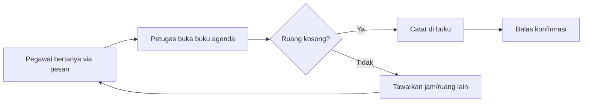
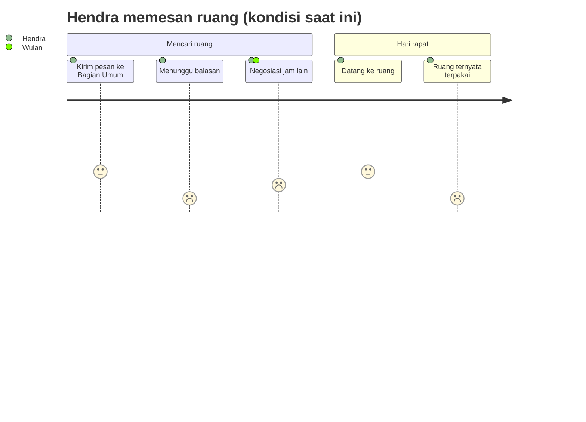
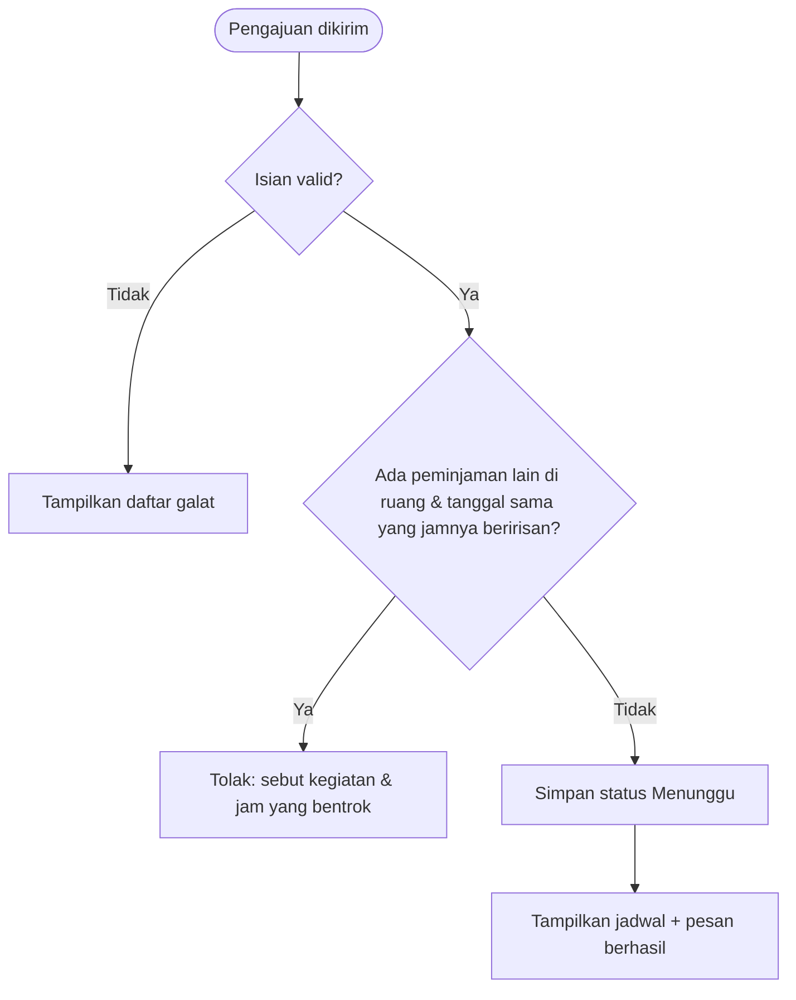
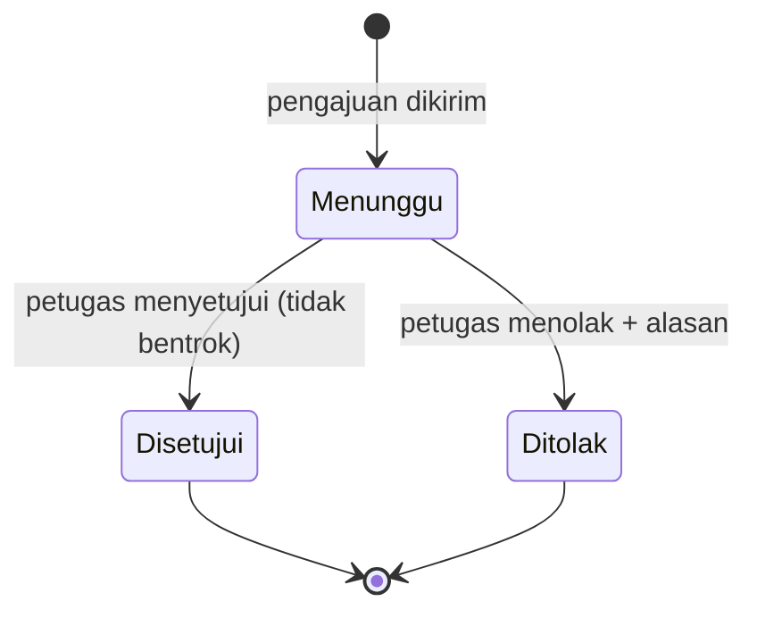
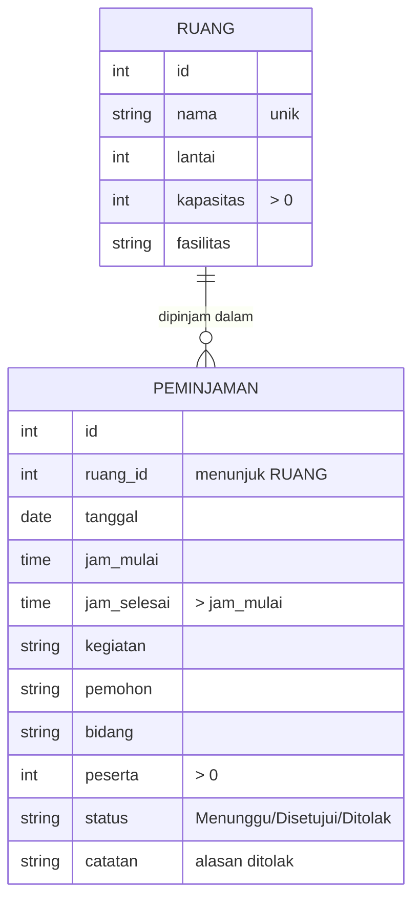
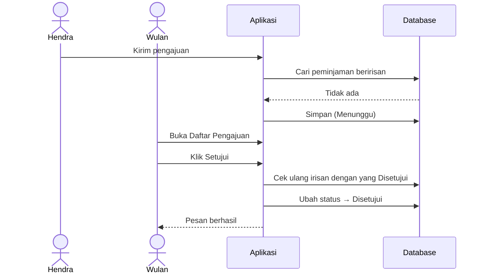

# PRD — Aplikasi Peminjaman Ruang Rapat

| | |
|---|---|
| **Versi** | 1.0 |
| **Tanggal** | 3 November 2026 |
| **Status** | Disetujui untuk proyek akhir pelatihan |
| **Penyusun** | Tim pengajar pelatihan Pemrograman Web untuk Administrasi & Keuangan |
| **Pemilik produk** | Bagian Umum, Kantor Unit Contoh (fiktif) |
| **Pemangku kepentingan** | Petugas Bagian Umum, seluruh pegawai pemohon ruang, kepala bidang |
| **Persetujuan diperlukan dari** | Pemilik produk |

> **Catatan pelatihan.** Seluruh nama, ruang, dan jadwal dalam dokumen ini fiktif.

### Riwayat revisi

| Versi | Tanggal | Penyusun | Ringkasan perubahan |
|---|---|---|---|
| 0.1 | 27 Oktober 2026 | Tim pengajar | Draf awal |
| 1.0 | 3 November 2026 | Tim pengajar | Penambahan cek bentrok saat persetujuan dan laporan tingkat pemakaian |

---

## 1. Ringkasan Eksekutif

Peminjaman ruang rapat di Kantor Unit Contoh saat ini dilakukan melalui pesan singkat dan buku agenda di meja Bagian Umum. Akibatnya jadwal sering bentrok, pemohon tidak tahu ruang mana yang kosong, dan Bagian Umum tidak memiliki data pemakaian ruang untuk perencanaan.

Aplikasi Peminjaman Ruang Rapat menyediakan jadwal harian visual per ruang, formulir pengajuan yang otomatis menolak jadwal bentrok dan peserta melebihi kapasitas, alur persetujuan oleh petugas, serta laporan tingkat pemakaian ruang per bulan. Sasaran utamanya adalah nol jadwal bentrok dan waktu pengecekan ketersediaan ruang kurang dari 30 detik.

Proyek ini dikerjakan sebagai proyek akhir Hari 2 dengan estimasi 3–4 jam. Proyek ini memperkenalkan satu konsep baru di luar materi inti, yaitu `JOIN` untuk menggabungkan dua tabel.

---

## 2. Latar Belakang dan Pernyataan Masalah

### 2.1 Konteks dan situasi saat ini

Kantor memiliki empat ruang pertemuan dengan kapasitas 8 hingga 80 orang. Pegawai menghubungi Bagian Umum untuk menanyakan ketersediaan ruang, lalu petugas memeriksa buku agenda dan mencatat pemesanan secara manual.

*Gambar 1 — Proses peminjaman saat ini.* Setiap pertanyaan memerlukan bolak-balik pesan, dan bentrok terjadi ketika dua petugas mencatat di tempat berbeda atau pemohon langsung memakai ruang tanpa mencatat.

### 2.2 Pernyataan masalah

> Pegawai **tidak dapat melihat ketersediaan ruang secara langsung** dan Bagian Umum **tidak memiliki satu catatan jadwal yang dapat dipercaya**, sehingga **jadwal rapat bentrok** dan **pemanfaatan ruang tidak terukur**.

### 2.3 Peluang dan alasan waktunya sekarang

Kasus ini melatih pengolahan data yang memiliki **status** (menunggu → disetujui/ditolak) dan **aturan bisnis lintas baris** (cek irisan jam), dua pola yang sangat umum dalam aplikasi administrasi.

### 2.4 Alternatif yang dipertimbangkan

| Alternatif | Kelebihan | Alasan tidak dipilih |
|---|---|---|
| Kalender bersama daring | Sudah tersedia di banyak kantor | Tidak memeriksa kapasitas; persetujuan tidak terpantau |
| Lembar kerja bersama | Mudah dibuat | Tidak dapat mencegah bentrok secara otomatis |
| Aplikasi web sederhana (dipilih) | Aturan bentrok dan kapasitas dipaksakan oleh sistem | Perlu dikembangkan |

---

## 3. Tujuan dan Metrik Keberhasilan

### 3.1 Tujuan bisnis

| ID | Tujuan | Metrik | Garis dasar | Target | Tenggat |
|---|---|---|---|---|---|
| G-01 | Menghilangkan jadwal bentrok | Jumlah peminjaman disetujui yang beririsan pada ruang & jam yang sama | Tidak terpantau | 0 | Sejak rilis |
| G-02 | Mempercepat pengecekan ketersediaan | Waktu pegawai mengetahui ruang kosong | ±10 menit (via pesan) | ≤ 30 detik | Demo |
| G-03 | Ruang dipakai sesuai kapasitas | Pengajuan dengan peserta > kapasitas yang lolos | Tidak terpantau | 0 | Sejak rilis |
| G-04 | Tersedia data pemakaian ruang | Laporan tingkat pemakaian per ruang per bulan | Tidak ada | Tersedia otomatis | Demo |

### 3.2 Metrik pelindung

| Metrik | Batas |
|---|---|
| Waktu mengisi pengajuan | ≤ 2 menit |
| Pengajuan sah yang tertolak keliru | 0 |

### 3.3 Cara pengukuran

| Metrik | Sumber data | Penanggung jawab | Frekuensi |
|---|---|---|---|
| Bentrok | Uji kriteria AC-03.x | Peserta | Saat pengujian |
| Waktu cek ketersediaan | Uji berwaktu saat demo | Peserta | Sekali |
| Tingkat pemakaian | Halaman Ruang | Bagian Umum | Bulanan |

### 3.4 Bukan tujuan

- Mengelola konsumsi, peralatan tambahan, atau undangan peserta rapat.
- Menjadi kalender pribadi pegawai.

---

## 4. Persona Pengguna dan Perjalanan Pengguna

### 4.1 Persona

#### P-01 — Hendra, pegawai pemohon

| Aspek | Keterangan |
|---|---|
| Peran | Staf bidang yang sering menyelenggarakan rapat koordinasi |
| Kemahiran teknologi | Pengguna umum |
| Frekuensi pemakaian | 1–3 kali per minggu |
| Tujuan utama | Mendapat ruang yang sesuai jumlah peserta tanpa bolak-balik bertanya |
| Titik frustrasi | Ruang ternyata sudah dipakai saat rapat akan dimulai |

#### P-02 — Wulan, petugas Bagian Umum

| Aspek | Keterangan |
|---|---|
| Peran | Mengelola jadwal dan menyetujui peminjaman ruang |
| Kemahiran teknologi | Mahir aplikasi perkantoran |
| Frekuensi pemakaian | Setiap hari |
| Tujuan utama | Jadwal tertib, keputusan setuju/tolak tercatat beserta alasannya |
| Titik frustrasi | Harus menjawab pertanyaan ketersediaan yang sama berulang kali |

### 4.2 Perjalanan pengguna

*Gambar 2 — Perjalanan saat ini.* Dua titik terendah, yaitu menunggu balasan dan ruang ternyata terpakai, diatasi dengan jadwal visual (FR-01) dan cek bentrok otomatis (FR-03).

### 4.3 User story

| ID | User story | Persona | Prioritas |
|---|---|---|---|
| US-01 | Sebagai pemohon, saya ingin melihat jadwal semua ruang pada suatu tanggal agar tahu jam yang kosong | P-01 | Must |
| US-02 | Sebagai pemohon, saya ingin mengajukan peminjaman lewat formulir | P-01 | Must |
| US-03 | Sebagai pemohon, saya ingin langsung diberi tahu bila jadwal bentrok atau peserta melebihi kapasitas | P-01 | Must |
| US-04 | Sebagai petugas, saya ingin menyetujui atau menolak pengajuan beserta alasannya | P-02 | Must |
| US-05 | Sebagai petugas, saya ingin melihat tingkat pemakaian tiap ruang per bulan | P-02 | Should |

---

## 5. Ruang Lingkup

### 5.1 Termasuk dalam ruang lingkup

| Kapabilitas | Prioritas | Persona |
|---|---|---|
| Jadwal harian visual per ruang | Must | P-01, P-02 |
| Formulir pengajuan dengan validasi kapasitas & bentrok | Must | P-01 |
| Daftar pengajuan dengan filter status/tanggal | Must | P-02 |
| Setujui / tolak dengan alasan | Must | P-02 |
| Laporan tingkat pemakaian ruang per bulan | Should | P-02 |

### 5.2 Di luar ruang lingkup

| Tidak termasuk | Alasan | Rencana |
|---|---|---|
| Login dan pembedaan peran pemohon/petugas | Di luar materi pelatihan | Fase 2 |
| Pembatalan oleh pemohon | Menambah status baru | Fase 2 |
| Pemesanan berulang (setiap minggu) | Logika tanggal lebih kompleks | Fase 2 |
| Notifikasi surel/pesan | Memerlukan layanan eksternal | Belum direncanakan |
| Tambah/ubah data ruang lewat aplikasi | Data ruang jarang berubah; cukup lewat phpMyAdmin | Fase 2 |

### 5.3 Ruang lingkup fase berikutnya

Login dengan dua peran, pembatalan pengajuan, pemesanan berulang, dan halaman pengelolaan ruang.

---

## 6. Kebutuhan Fungsional

### 6.1 Modul Jadwal

#### FR-01 — Jadwal harian visual

| | |
|---|---|
| **Prioritas** | Must · **Persona** P-01, P-02 · **Tujuan** G-02 · **Terkait** US-01 |

**Deskripsi.** Untuk tanggal terpilih (bawaan: hari ini), setiap ruang ditampilkan sebagai lintasan jam layanan 07:30–17:00. Setiap peminjaman menjadi balok sesuai jam mulai dan selesai: hijau untuk *Disetujui*, kuning berarsir untuk *Menunggu*. Pengajuan *Ditolak* tidak ditampilkan. Tersedia tombol tanggal sebelumnya, berikutnya, dan hari ini, serta tombol *+ Ajukan* per ruang yang membuka formulir dengan ruang dan tanggal terisi.

Kartu ringkasan menampilkan jumlah ruang, jumlah peminjaman disetujui beserta total jam pada tanggal tersebut, dan jumlah pengajuan menunggu.

### 6.2 Modul Pengajuan

#### FR-02 — Formulir pengajuan

| | |
|---|---|
| **Prioritas** | Must · **Persona** P-01 · **Tujuan** G-03 · **Terkait** US-02, US-03 |

**Penanganan kondisi khusus.**

| Kondisi | Perilaku sistem |
|---|---|
| Tanggal sebelum hari ini | Ditolak |
| Tanggal jatuh pada Sabtu/Minggu | Ditolak: layanan hanya hari kerja |
| Jam di luar 07:30–17:00 | Ditolak dengan menyebut jam layanan |
| Jam selesai ≤ jam mulai | Ditolak |
| Peserta > kapasitas ruang | Ditolak dengan menyebut kapasitas; peringatan sudah muncul di peramban sebelum dikirim |
| Isian wajib kosong | Ditolak |
| Semua valid | Disimpan dengan status **Menunggu**, lalu pengguna diarahkan ke jadwal tanggal tersebut |

#### FR-03 — Pencegahan jadwal bentrok

| | |
|---|---|
| **Prioritas** | Must · **Tujuan** G-01 · **Terkait** US-03 |

**Deskripsi.** Dua peminjaman dinyatakan **bentrok** bila ruang dan tanggalnya sama, keduanya berstatus *Menunggu* atau *Disetujui*, dan rentang jamnya beririsan, yaitu **mulai A < selesai B** dan **selesai A > mulai B**. Rapat yang berakhir pukul 10:00 tidak bentrok dengan rapat yang dimulai pukul 10:00.

*Gambar 3 — Alur pengajuan.* Pesan bentrok menyebutkan nama kegiatan dan jamnya agar pemohon dapat langsung memilih jam lain.

### 6.3 Modul Persetujuan

#### FR-04 — Daftar dan pemrosesan pengajuan

| | |
|---|---|
| **Prioritas** | Must · **Persona** P-02 · **Tujuan** G-01 · **Terkait** US-04 |

**Deskripsi.** Daftar menampilkan tanggal, jam, ruang, kegiatan, pemohon, peserta/kapasitas, dan status, dengan filter status (bawaan: *Menunggu*) dan tanggal. Jumlah pengajuan menunggu tampil di menu. Pengajuan *Menunggu* memiliki tombol *Setujui* dan *Tolak*; penolakan wajib disertai alasan.

Saat menyetujui, sistem memeriksa ulang irisan jam terhadap peminjaman yang **sudah disetujui**. Bila ada, persetujuan dibatalkan dengan pesan galat. Pengajuan yang sudah diproses tidak dapat diproses ulang.

*Gambar 4 — Status pengajuan.* Hanya status *Menunggu* yang dapat berubah; status akhir bersifat tetap pada rilis ini.

### 6.4 Modul Laporan

#### FR-05 — Tingkat pemakaian ruang

| | |
|---|---|
| **Prioritas** | Should · **Persona** P-02 · **Tujuan** G-04 · **Terkait** US-05 |

**Deskripsi.** Untuk bulan terpilih, tampilkan per ruang: kapasitas, berapa kali dipakai, total jam, rata-rata peserta beserta persentase keterisian kursi, dan **tingkat pemakaian** = total jam disetujui ÷ (jumlah hari kerja × 9,5 jam). Ruang yang belum pernah dipakai tetap muncul dengan nilai nol.

---

## 7. Kebutuhan Non-Fungsional

### 7.1 Kategori umum

| ID | Kategori | Kebutuhan | Ambang | Cara verifikasi |
|---|---|---|---|---|
| NFR-01 | Kinerja | Jadwal harian tampil cepat | ≤ 1 detik dengan 2.000 peminjaman | Uji data diperbanyak |
| NFR-02 | Kegunaan | Pemohon baru dapat mengajukan tanpa panduan | ≤ 2 menit | Uji dengan rekan |
| NFR-03 | Tampilan | Dapat dipakai di ponsel | Lebar 360 px; lintasan jadwal dapat digeser | Mode perangkat (F12) |
| NFR-04 | Bahasa & format | Antarmuka berbahasa Indonesia; tanggal "Selasa, 3 November 2026"; jam 24 jam | 100% halaman | Pemeriksaan visual |
| NFR-05 | Keterpeliharaan | Komentar penjelasan di setiap berkas | Seluruh berkas | Tinjauan kode |

### 7.2 Keamanan dan kepatuhan

Rujukan: **OWASP Top 10 (2021)**.

| ID | Kebutuhan | Rujukan | Cara verifikasi |
|---|---|---|---|
| NFR-06 | Kueri dengan isian pengguna memakai *prepared statement* | A03 Injection | Isi kegiatan dengan tanda petik `'`; data tersimpan normal |
| NFR-07 | Teks pengguna di-*escape* saat ditampilkan | A03 (XSS) | Kegiatan `<i>uji</i>` tampil sebagai teks |
| NFR-08 | Perubahan status hanya lewat POST dan hanya dari status *Menunggu* | A01 Broken Access Control | Mengirim ulang permintaan setujui untuk pengajuan yang sudah diproses ditolak |
| NFR-09 | Integritas data dijaga juga di database: status terbatas pada tiga nilai, jam selesai > jam mulai, ruang wajib terdaftar | Prinsip *defense in depth* | Uji `INSERT` langsung di phpMyAdmin dengan nilai salah → ditolak database |

---

## 8. Model Data dan Entitas

*Gambar 5 — Entitas data.* Satu ruang dapat memiliki banyak peminjaman; setiap peminjaman tepat milik satu ruang. Karena nama ruang disimpan di tabel terpisah, halaman daftar memakai `JOIN` untuk menampilkannya — konsep baru yang dijelaskan dalam komentar kode.

---

## 9. Alur Sistem dan Integrasi

Aplikasi berdiri sendiri tanpa integrasi eksternal.

*Gambar 6 — Urutan pengajuan hingga persetujuan.* Pemeriksaan dilakukan dua kali, saat pengajuan dan saat persetujuan, untuk berjaga-jaga bila data berubah di antara keduanya.

---

## 10. Rancangan Antarmuka dan Pengalaman Pengguna

Menu tetap: **Jadwal · Ajukan · Daftar Pengajuan (n) · Ruang**.

| Halaman | Elemen utama | Catatan pengalaman pengguna |
|---|---|---|
| Jadwal | Navigasi tanggal, 3 kartu, lintasan per ruang | Arahkan tetikus ke balok untuk melihat rincian |
| Ajukan | Formulir 8 isian | Info fasilitas dan peringatan kapasitas muncul seketika |
| Daftar Pengajuan | Filter, tabel, tombol Setujui/Tolak + alasan | Lencana status berwarna |
| Ruang | Pilihan bulan, tabel pemakaian, batang persentase | Keterangan cara membaca angka |

---

## 11. Kriteria Penerimaan

Data uji memakai `database.sql` bawaan. Beberapa kriteria memakai tanggal di masa depan; sesuaikan dengan tanggal saat pengujian bila diperlukan.

| ID | Kriteria (Given / When / Then) |
|---|---|
| AC-01.1 | **Given** tanggal 4 November 2026, **when** jadwal dibuka, **then** Aula menampilkan balok hijau 08:00–16:00 dan Ruang Rapat Utama menampilkan balok kuning 09:00–10:30 |
| AC-01.2 | **Given** jadwal, **when** tombol *+ Ajukan* pada Ruang Rapat Kecil B diklik, **then** formulir terbuka dengan ruang dan tanggal terisi |
| AC-02.1 | **Given** Ruang Rapat Kecil A (kapasitas 8), **when** peserta diisi 12, **then** peringatan muncul sebelum dikirim dan server menolak bila tetap dikirim |
| AC-02.2 | **Given** tanggal jatuh pada hari Sabtu, **when** dikirim, **then** ditolak dengan pesan hari kerja |
| AC-03.1 | **Given** Ruang Rapat Utama 4 Nov 09:00–10:30 berstatus Menunggu, **when** diajukan 10:00–11:00 di ruang & tanggal sama, **then** ditolak dengan menyebut "Rapat koordinasi lapangan" |
| AC-03.2 | **Given** peminjaman 09:00–10:30, **when** diajukan 10:30–11:30, **then** diterima karena tidak beririsan |
| AC-04.1 | **Given** pengajuan Menunggu, **when** Tolak ditekan tanpa alasan, **then** peramban meminta alasan diisi |
| AC-04.2 | **Given** pengajuan sudah Disetujui, **when** permintaan setujui dikirim ulang, **then** muncul pesan "sudah diproses" |
| AC-05.1 | **Given** bulan November 2026, **then** halaman Ruang menampilkan 21 hari kerja × 9,5 jam = 199,5 jam tersedia per ruang |

**Matriks keterlacakan**

| Tujuan | Kebutuhan | Kriteria |
|---|---|---|
| G-01 | FR-03, FR-04 | AC-03.1, AC-03.2, AC-04.2 |
| G-02 | FR-01 | AC-01.1, AC-01.2 |
| G-03 | FR-02 | AC-02.1, AC-02.2 |
| G-04 | FR-05 | AC-05.1 |

---

## 12. Asumsi, Ketergantungan, dan Risiko

### 12.1 Asumsi

- `[ASUMSI]` Jam layanan 07:30–17:00 pada hari kerja; hari libur nasional belum diperhitungkan.
- `[ASUMSI]` Satu petugas Bagian Umum memproses pengajuan.
- `[ASUMSI]` Data ruang dikelola melalui phpMyAdmin.

### 12.2 Ketergantungan

XAMPP (Apache, PHP 8, MySQL/MariaDB). Tidak memerlukan internet.

### 12.3 Risiko

| ID | Risiko | Dampak | Mitigasi |
|---|---|---|---|
| RSK-01 | Konsep `JOIN` baru bagi peserta | Waktu pengerjaan bertambah | Kode `JOIN` disediakan lengkap dengan komentar; peserta cukup memahami polanya |
| RSK-02 | Tanpa login, siapa pun dapat menyetujui | Penyalahgunaan di jaringan bersama | Jalankan secara lokal; login di fase 2 |
| RSK-03 | Hari libur nasional tidak dikenali | Pengajuan pada hari libur tetap diterima | Petugas menolak manual dengan alasan; daftar hari libur di fase 2 |

### 12.4 Pertanyaan terbuka

- `[TBD]` Apakah perlu batas durasi maksimum per peminjaman (misal 4 jam untuk ruang kecil)?
- `[TBD]` Berapa hari ke depan pengajuan boleh dibuat?

---

## 13. Rencana Rilis dan Milestone

```mermaid
gantt
    title Rencana pengerjaan proyek akhir
    dateFormat HH:mm
    axisFormat %H:%M
    section Persiapan
    Impor database, uji koneksi      :b1, 13:15, 15m
    section Must
    Formulir pengajuan + validasi    :b2, after b1, 50m
    Cek bentrok (FR-03)              :b3, after b2, 30m
    Daftar + setujui/tolak (FR-04)   :b4, after b3, 40m
    Jadwal visual (FR-01)            :b5, after b4, 40m
    section Should
    Laporan pemakaian (FR-05)        :b6, after b5, 25m
    section Penutup
    Uji kriteria dan demo            :b7, after b6, 20m
```

*Gambar 7 — Rencana pengerjaan.* Jadwal visual sengaja dikerjakan setelah alur data selesai, karena tampilannya bergantung pada data pengajuan yang benar.

---

## 14. Lampiran

- **Glosarium.** *Beririsan* — dua rentang waktu yang sebagian atau seluruhnya bertumpuk. *JOIN* — perintah SQL untuk menggabungkan baris dari dua tabel berdasarkan kolom penghubung. *Tingkat pemakaian* — persentase jam ruang terpakai terhadap jam layanan yang tersedia.
- **Berkas terkait.** `README.md`, `database.sql`.
