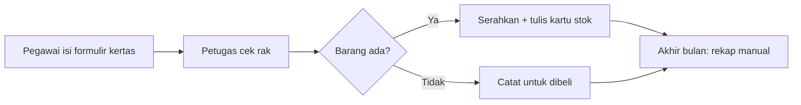
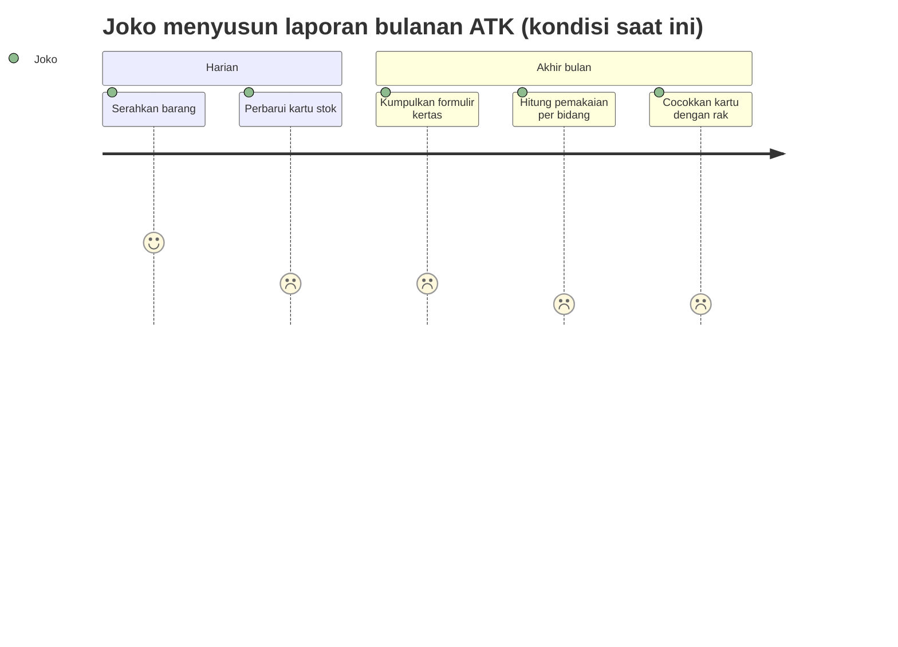
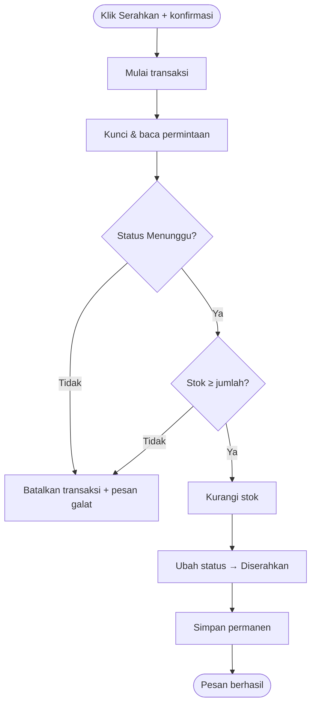
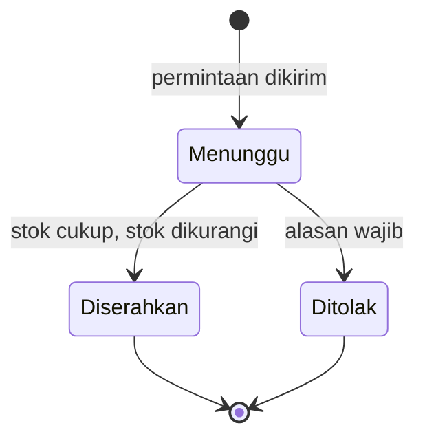
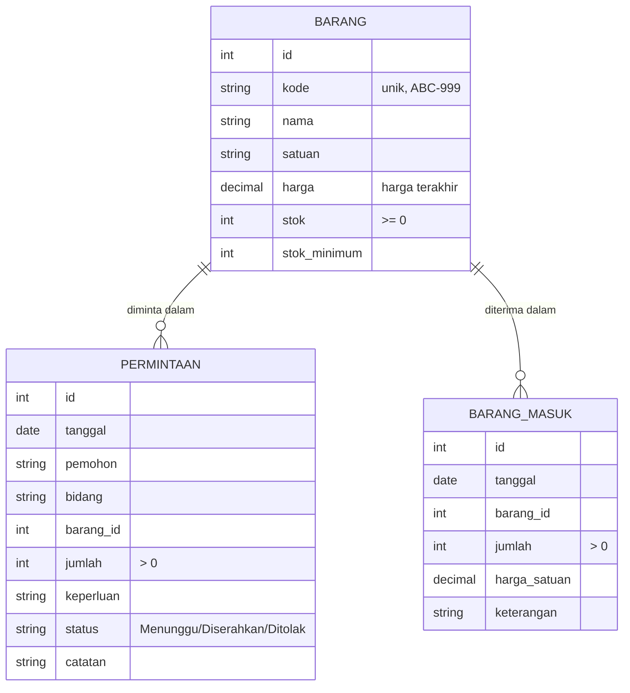
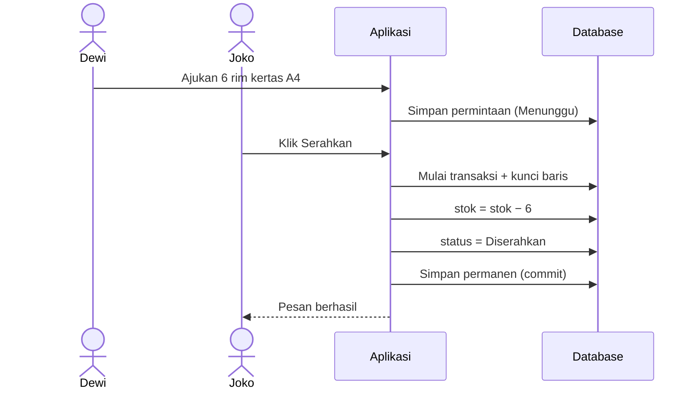

# PRD — Aplikasi Permintaan & Persediaan ATK

| | |
|---|---|
| **Versi** | 1.0 |
| **Tanggal** | 3 November 2026 |
| **Status** | Disetujui untuk proyek akhir pelatihan |
| **Penyusun** | Tim pengajar pelatihan Pemrograman Web untuk Administrasi & Keuangan |
| **Pemilik produk** | Bagian Umum, Kantor Unit Contoh (fiktif) |
| **Pemangku kepentingan** | Petugas gudang ATK, pegawai pemohon, Bagian Keuangan & Umum |
| **Persetujuan diperlukan dari** | Pemilik produk |

> **Catatan pelatihan.** Seluruh barang, harga, nama, dan angka dalam dokumen ini fiktif.

### Riwayat revisi

| Versi | Tanggal | Penyusun | Ringkasan perubahan |
|---|---|---|---|
| 0.1 | 27 Oktober 2026 | Tim pengajar | Draf awal |
| 1.0 | 3 November 2026 | Tim pengajar | Penambahan laporan mutasi stok dan transaksi database |

---

## 1. Ringkasan Eksekutif

Permintaan alat tulis kantor (ATK) saat ini diajukan dengan formulir kertas, sementara stok dicatat pada kartu stok manual. Petugas sering baru menyadari stok habis ketika ada permintaan, nilai persediaan tidak diketahui tanpa menghitung fisik, dan rekap pemakaian per bidang disusun manual setiap bulan.

Aplikasi Permintaan & Persediaan ATK menyatukan tiga proses, yaitu permintaan barang oleh pegawai, penyerahan atau penolakan oleh petugas, dan pencatatan barang masuk. Stok berubah otomatis dan selalu tercatat sebabnya. Dasbor menandai barang yang perlu diisi ulang, sedangkan laporan bulanan menyajikan pemakaian per bidang dan mutasi stok (awal, masuk, keluar, akhir).

Sasaran utamanya adalah stok tidak pernah minus, barang menipis terdeteksi sebelum habis, dan laporan bulanan tersedia dalam kurang dari satu menit. Proyek ini memperkenalkan **transaksi database** (`beginTransaction`/`commit`/`rollBack`) sebagai konsep lanjutan.

---

## 2. Latar Belakang dan Pernyataan Masalah

### 2.1 Konteks dan situasi saat ini

*Gambar 1 — Proses saat ini.* Kartu stok hanya diperbarui saat petugas sempat, sehingga angka di kartu dan di rak sering berbeda. Rekap per bidang memerlukan pengumpulan seluruh formulir kertas.

### 2.2 Pernyataan masalah

> Petugas gudang ATK **tidak mengetahui stok dan nilai persediaan yang akurat setiap saat**, sehingga **barang habis tanpa peringatan** dan **rekap pemakaian per bidang memakan waktu berjam-jam** setiap bulan.

### 2.3 Peluang dan alasan waktunya sekarang

Kasus persediaan melatih pola penting dalam aplikasi keuangan: satu tindakan mengubah dua tabel sekaligus (status permintaan dan stok barang), sehingga keduanya harus berhasil atau gagal bersama.

### 2.4 Alternatif yang dipertimbangkan

| Alternatif | Kelebihan | Alasan tidak dipilih |
|---|---|---|
| Kartu stok di Excel | Familier | Tidak terhubung dengan permintaan; rawan rumus terhapus |
| Modul persediaan pada sistem perusahaan | Lengkap | Di luar kendali unit; terlalu besar untuk ATK harian |
| Aplikasi web sederhana (dipilih) | Stok otomatis, riwayat tercatat, laporan instan | Perlu dikembangkan |

---

## 3. Tujuan dan Metrik Keberhasilan

### 3.1 Tujuan bisnis

| ID | Tujuan | Metrik | Garis dasar | Target | Tenggat |
|---|---|---|---|---|---|
| G-01 | Stok selalu akurat dan tidak pernah minus | Jumlah barang dengan stok < 0 | Tidak terpantau | 0 | Sejak rilis |
| G-02 | Barang menipis terdeteksi lebih awal | Barang dengan stok ≤ minimum yang tampil di dasbor | Tidak ada peringatan | 100% terdeteksi | Sejak rilis |
| G-03 | Mempercepat laporan bulanan | Waktu menyusun pemakaian per bidang & mutasi stok | ±3 jam | ≤ 1 menit | Demo |
| G-04 | Permintaan diproses tertib | Permintaan yang diproses dua kali | Tidak terpantau | 0 | Sejak rilis |

### 3.2 Metrik pelindung

| Metrik | Batas |
|---|---|
| Waktu mengajukan permintaan | ≤ 1 menit |
| Perubahan stok tanpa riwayat | 0 (stok hanya berubah lewat penyerahan atau barang masuk) |

### 3.3 Cara pengukuran

| Metrik | Sumber data | Penanggung jawab | Frekuensi |
|---|---|---|---|
| Stok minus | Halaman Barang & Stok | Petugas | Harian |
| Barang menipis | Dasbor | Petugas | Harian |
| Waktu laporan | Uji berwaktu saat demo | Peserta | Sekali |

### 3.4 Bukan tujuan

- Mengelola proses pengadaan (permintaan penawaran, pesanan pembelian, pembayaran).
- Menghitung nilai persediaan dengan metode akuntansi tertentu (FIFO/rata-rata). Rilis ini memakai **harga satuan terakhir** sebagai pendekatan sederhana.

---

## 4. Persona Pengguna dan Perjalanan Pengguna

### 4.1 Persona

#### P-01 — Dewi, pegawai pemohon

| Aspek | Keterangan |
|---|---|
| Peran | Staf bidang yang membutuhkan ATK |
| Kemahiran teknologi | Pengguna umum |
| Frekuensi pemakaian | 1–4 kali per bulan |
| Tujuan utama | Mengetahui stok sebelum meminta, permintaan cepat diproses |
| Titik frustrasi | Datang ke gudang, ternyata barang habis |

#### P-02 — Joko, petugas gudang ATK

| Aspek | Keterangan |
|---|---|
| Peran | Menyerahkan barang, mencatat barang masuk, menyusun laporan |
| Kemahiran teknologi | Mahir Excel |
| Frekuensi pemakaian | Setiap hari |
| Tujuan utama | Stok akurat, tahu kapan harus membeli, laporan bulanan cepat |
| Titik frustrasi | Kartu stok tidak cocok dengan rak; rekap bulanan memakan waktu |

### 4.2 Perjalanan pengguna

*Gambar 2 — Perjalanan saat ini.* Pembaruan stok otomatis saat penyerahan (FR-04) dan laporan mutasi (FR-07) menghapus tiga langkah bernilai terendah.

### 4.3 User story

| ID | User story | Persona | Prioritas |
|---|---|---|---|
| US-01 | Sebagai pemohon, saya ingin melihat stok saat memilih barang agar tidak meminta barang yang habis | P-01 | Must |
| US-02 | Sebagai pemohon, saya ingin mengajukan permintaan lewat formulir | P-01 | Must |
| US-03 | Sebagai petugas, saya ingin menyerahkan barang dan stok berkurang otomatis | P-02 | Must |
| US-04 | Sebagai petugas, saya ingin mencatat barang masuk dan stok bertambah otomatis | P-02 | Must |
| US-05 | Sebagai petugas, saya ingin diberi tahu barang yang menipis | P-02 | Must |
| US-06 | Sebagai petugas, saya ingin mengelola data barang (kode, nama, harga, stok minimum) | P-02 | Should |
| US-07 | Sebagai petugas, saya ingin laporan pemakaian per bidang dan mutasi stok per bulan | P-02 | Should |

---

## 5. Ruang Lingkup

### 5.1 Termasuk dalam ruang lingkup

| Kapabilitas | Prioritas | Persona |
|---|---|---|
| Formulir permintaan dengan informasi stok | Must | P-01 |
| Serahkan/tolak permintaan dengan pembaruan stok otomatis | Must | P-02 |
| Pencatatan barang masuk | Must | P-02 |
| Dasbor: nilai persediaan, stok menipis, antrean | Must | P-02 |
| Kelola data induk barang | Should | P-02 |
| Laporan bulanan pemakaian & mutasi | Should | P-02 |

### 5.2 Di luar ruang lingkup

| Tidak termasuk | Alasan | Rencana |
|---|---|---|
| Login & peran | Di luar materi pelatihan | Fase 2 |
| Satu permintaan berisi banyak barang | Memerlukan tabel rincian (*master–detail*) | Fase 2 |
| Penyesuaian stok hasil *stock opname* | Memerlukan jenis mutasi baru | Fase 2 |
| Penghapusan barang | Barang yang punya riwayat tidak boleh dihapus | Fase 2 (penonaktifan) |
| Proses pengadaan dan pembayaran | Proses lintas bagian | Tidak direncanakan |

### 5.3 Ruang lingkup fase berikutnya

Permintaan multi-barang, *stock opname*, penonaktifan barang, login, dan ekspor laporan ke Excel.

---

## 6. Kebutuhan Fungsional

### 6.1 Modul Permintaan

#### FR-01 — Formulir permintaan

| | |
|---|---|
| **Prioritas** | Must · **Persona** P-01 · **Tujuan** G-04 · **Terkait** US-01, US-02 |

**Deskripsi.** Pemohon mengisi nama, bidang, barang (pilihan menampilkan stok saat ini), jumlah, dan keperluan. Tanggal permintaan diisi otomatis dengan tanggal server. Permintaan tersimpan dengan status **Menunggu**. Bila jumlah melebihi stok, permintaan tetap diterima dan pesan memberi tahu stok yang tersedia.

| Kondisi | Perilaku sistem |
|---|---|
| Nama atau keperluan kosong | Ditolak |
| Bidang atau barang di luar daftar | Ditolak |
| Jumlah bukan bilangan bulat 1–20 | Ditolak dengan menyebut batas |

#### FR-02 — Daftar permintaan

| | |
|---|---|
| **Prioritas** | Must · **Persona** P-02 |

**Deskripsi.** Menampilkan permintaan dengan filter status (bawaan: *Menunggu*), berisi stok terkini untuk setiap barang. Jumlah permintaan menunggu tampil di menu.

### 6.2 Modul Pemrosesan

#### FR-03 — Tolak permintaan

| | |
|---|---|
| **Prioritas** | Must · **Tujuan** G-04 |

**Deskripsi.** Petugas menolak dengan alasan wajib. Stok tidak berubah.

#### FR-04 — Serahkan permintaan

| | |
|---|---|
| **Prioritas** | Must · **Persona** P-02 · **Tujuan** G-01, G-04 · **Terkait** US-03 |

**Deskripsi.** Penyerahan mengurangi stok barang dan mengubah status menjadi *Diserahkan* **dalam satu transaksi database**. Bila stok tidak cukup, permintaan sudah diproses, atau terjadi galat apa pun, seluruh perubahan dibatalkan. Tombol *Serahkan* dinonaktifkan bila stok kurang dari jumlah yang diminta.

*Gambar 3 — Alur penyerahan.* Langkah F dan G harus selalu terjadi bersama. Tanpa transaksi, stok bisa berkurang sementara status tetap *Menunggu* jika terjadi galat di antaranya, dan permintaan dapat diserahkan dua kali.

*Gambar 4 — Status permintaan.*

### 6.3 Modul Persediaan

#### FR-05 — Barang masuk

| | |
|---|---|
| **Prioritas** | Must · **Persona** P-02 · **Tujuan** G-01 · **Terkait** US-04 |

**Deskripsi.** Petugas mencatat tanggal terima (tidak boleh melewati hari ini), barang, jumlah (≥ 1), harga satuan (≥ 0), dan keterangan. Dalam satu transaksi, sistem menyimpan riwayat, menambah stok, dan memperbarui harga satuan terakhir. Saat barang dipilih, harga terakhir terisi otomatis dan perkiraan nilai pembelian dihitung seketika. Lima belas catatan terbaru ditampilkan di bawah formulir.

#### FR-06 — Data induk barang

| | |
|---|---|
| **Prioritas** | Should · **Terkait** US-06 |

**Deskripsi.** Daftar barang dengan pencarian (nama/kode), saringan *hanya stok menipis*, indikator kondisi stok (aman/mendekati batas/menipis), nilai per barang, dan total nilai persediaan. Formulir tambah/ubah berisi kode (pola `ABC-999`, unik, diusulkan otomatis), nama, satuan, harga, dan stok minimum. **Stok hanya dapat diisi saat barang baru dibuat**; setelah itu stok hanya berubah melalui FR-04 dan FR-05 agar setiap perubahan memiliki riwayat.

### 6.4 Modul Dasbor dan Laporan

#### FR-07 — Dasbor

| | |
|---|---|
| **Prioritas** | Must · **Tujuan** G-02 · **Terkait** US-05 |

**Deskripsi.** Empat kartu: jenis barang, nilai persediaan (stok × harga), jumlah barang menipis (merah bila > 0), dan permintaan menunggu. Tabel barang perlu diisi ulang dengan **saran beli = 2 × stok minimum − stok**. Grafik nilai pemakaian per bidang untuk bulan penyerahan terakhir. Antrean lima permintaan tertua dengan tanda *stok cukup* / *stok kurang*.

#### FR-08 — Laporan bulanan

| | |
|---|---|
| **Prioritas** | Should · **Tujuan** G-03 · **Terkait** US-07 |

**Deskripsi.** Untuk bulan terpilih: (1) pemakaian per bidang berupa jumlah penyerahan, nilai rupiah, dan porsi; (2) mutasi per barang berupa stok awal, masuk, keluar, dan stok akhir, dengan aturan **stok akhir = stok awal + masuk − keluar**. Stok akhir bulan dihitung mundur dari stok saat ini dikurangi mutasi setelah bulan tersebut. Tersedia tombol cetak.

---

## 7. Kebutuhan Non-Fungsional

### 7.1 Kategori umum

| ID | Kategori | Kebutuhan | Ambang | Cara verifikasi |
|---|---|---|---|---|
| NFR-01 | Kinerja | Halaman laporan tampil cepat | ≤ 2 detik untuk 200 barang dan 10.000 permintaan | Uji data diperbanyak |
| NFR-02 | Integritas | Stok tidak pernah minus | Dijaga aplikasi **dan** aturan `CHECK (stok >= 0)` di database | Uji serahkan melebihi stok |
| NFR-03 | Konsistensi | Perubahan dua tabel bersifat semua-atau-tidak-sama-sekali | 100% proses serahkan & barang masuk | Tinjauan kode (transaksi) |
| NFR-04 | Tampilan | Dapat dipakai di ponsel | Lebar 360 px | Mode perangkat (F12) |
| NFR-05 | Keterpeliharaan | Komentar penjelasan di setiap berkas | Seluruh berkas | Tinjauan kode |

### 7.2 Keamanan dan kepatuhan

Rujukan: **OWASP Top 10 (2021)**.

| ID | Kebutuhan | Rujukan | Cara verifikasi |
|---|---|---|---|
| NFR-06 | Kueri dengan isian pengguna memakai *prepared statement* | A03 Injection | Cari barang dengan `' OR '1'='1`; tidak ada galat SQL |
| NFR-07 | Teks pengguna di-*escape* | A03 (XSS) | Keperluan `<b>uji</b>` tampil sebagai teks |
| NFR-08 | Perubahan status hanya lewat POST, dari status *Menunggu*, dengan penguncian baris | A01, A04 Insecure Design | Mengirim ulang permintaan serahkan → ditolak "sudah diproses" |

---

## 8. Model Data dan Entitas

*Gambar 5 — Entitas data.* `BARANG.stok` adalah saldo berjalan. Setiap perubahannya memiliki pasangan riwayat: pengurangan di `PERMINTAAN` (status *Diserahkan*) dan penambahan di `BARANG_MASUK`. Prinsip ini sama dengan buku besar: saldo harus dapat ditelusuri dari mutasinya.

---

## 9. Alur Sistem dan Integrasi

Aplikasi berdiri sendiri tanpa integrasi eksternal.

*Gambar 6 — Urutan permintaan hingga penyerahan.*

---

## 10. Rancangan Antarmuka dan Pengalaman Pengguna

Menu tetap: **Dasbor · Permintaan (n) · Barang & Stok · Barang Masuk · Laporan**.

| Halaman | Elemen utama | Catatan pengalaman pengguna |
|---|---|---|
| Dasbor | 4 kartu, tabel isi ulang, grafik, antrean | Warna merah hanya untuk hal yang perlu tindakan |
| Permintaan | Formulir di atas, daftar di bawah | Stok terlihat di pilihan barang; tombol Serahkan redup bila stok kurang |
| Barang & Stok | Pencarian, saringan menipis, indikator batang | Total nilai persediaan di baris bawah |
| Barang Masuk | Formulir + riwayat | Harga terakhir terisi otomatis, nilai pembelian dihitung seketika |
| Laporan | Pilihan bulan, dua tabel, tombol cetak | Rumus mutasi dicantumkan di bawah tabel |

---

## 11. Kriteria Penerimaan

Data uji memakai `database.sql` bawaan.

| ID | Kriteria (Given / When / Then) |
|---|---|
| AC-01.1 | **Given** formulir permintaan, **when** pilihan barang dibuka, **then** setiap barang menampilkan stoknya |
| AC-01.2 | **Given** jumlah 25, **when** dikirim, **then** ditolak dengan batas 1–20 |
| AC-04.1 | **Given** permintaan 3 kotak spidol dengan stok 2, **then** tombol Serahkan redup; bila dipaksa dikirim, muncul pesan "tidak cukup" dan stok tetap 2 |
| AC-04.2 | **Given** permintaan 6 rim kertas A4 dengan stok 42, **when** diserahkan, **then** stok menjadi 36 dan status *Diserahkan* |
| AC-04.3 | **Given** permintaan sudah diserahkan, **when** permintaan serahkan dikirim ulang, **then** muncul pesan "sudah diproses" dan stok tidak berubah |
| AC-05.1 | **Given** stok spidol 2, **when** dicatat barang masuk 6 kotak @ Rp 47.000, **then** stok menjadi 8 dan harga satuan menjadi 47.000 |
| AC-06.1 | **Given** ubah barang, **then** isian stok tidak dapat diedit |
| AC-07.1 | **Given** data bawaan, **then** dasbor menampilkan 3 barang menipis dan nilai persediaan Rp 5.126.000 |
| AC-08.1 | **Given** laporan Oktober 2026, **then** tidak ada stok awal yang minus dan setiap baris memenuhi awal + masuk − keluar = akhir |

**Matriks keterlacakan**

| Tujuan | Kebutuhan | Kriteria |
|---|---|---|
| G-01 | FR-04, FR-05, FR-06 | AC-04.1, AC-04.2, AC-05.1, AC-06.1 |
| G-02 | FR-07 | AC-07.1 |
| G-03 | FR-08 | AC-08.1 |
| G-04 | FR-01, FR-02, FR-03, FR-04 | AC-01.1, AC-01.2, AC-04.3 |

---

## 12. Asumsi, Ketergantungan, dan Risiko

### 12.1 Asumsi

- `[ASUMSI]` Nilai persediaan memakai harga satuan terakhir, bukan metode akuntansi tertentu.
- `[ASUMSI]` Batas 20 satuan per permintaan adalah angka contoh.
- `[ASUMSI]` Satu permintaan berisi satu jenis barang.

### 12.2 Ketergantungan

XAMPP (Apache, PHP 8, MySQL/MariaDB dengan mesin InnoDB yang mendukung transaksi). Chart.js disertakan lokal.

### 12.3 Risiko

| ID | Risiko | Dampak | Mitigasi |
|---|---|---|---|
| RSK-01 | Konsep transaksi database baru bagi peserta | Waktu pengerjaan bertambah | Kode `proses.php` dan `masuk.php` dikomentari langkah demi langkah |
| RSK-02 | Stok awal tidak sesuai fisik | Laporan mutasi tidak akurat | Isi stok awal dari hasil hitung fisik saat barang dibuat |
| RSK-03 | Tanpa login | Siapa pun dapat menyerahkan barang | Jalankan lokal; login di fase 2 |

### 12.4 Pertanyaan terbuka

- `[TBD]` Apakah permintaan yang melebihi stok sebaiknya langsung ditolak saat diajukan?
- `[TBD]` Rumus saran beli (2 × minimum − stok) perlu dikonfirmasi dengan pola pengadaan unit.

---

## 13. Rencana Rilis dan Milestone

```mermaid
gantt
    title Rencana pengerjaan proyek akhir
    dateFormat HH:mm
    axisFormat %H:%M
    section Persiapan
    Impor database, uji koneksi      :c1, 13:15, 15m
    section Must
    Permintaan: formulir + daftar    :c2, after c1, 45m
    Serahkan/tolak dengan transaksi  :c3, after c2, 40m
    Barang masuk                     :c4, after c3, 30m
    Dasbor                           :c5, after c4, 30m
    section Should
    Data induk barang                :c6, after c5, 25m
    Laporan bulanan                  :c7, after c6, 25m
    section Penutup
    Uji kriteria dan demo            :c8, after c7, 15m
```

*Gambar 7 — Rencana pengerjaan.* Ketiga modul Must membentuk siklus lengkap stok (keluar dan masuk) sehingga aplikasi sudah bernilai sebelum modul Should dikerjakan.

---

## 14. Lampiran

- **Glosarium.** *Mutasi* — perubahan stok (masuk/keluar). *Transaksi database* — sekelompok perintah yang disimpan bersama atau dibatalkan bersama. *Stok minimum* — batas stok yang memicu peringatan isi ulang. *Nilai persediaan* — total stok × harga satuan.
- **Berkas terkait.** `README.md`, `database.sql`.
